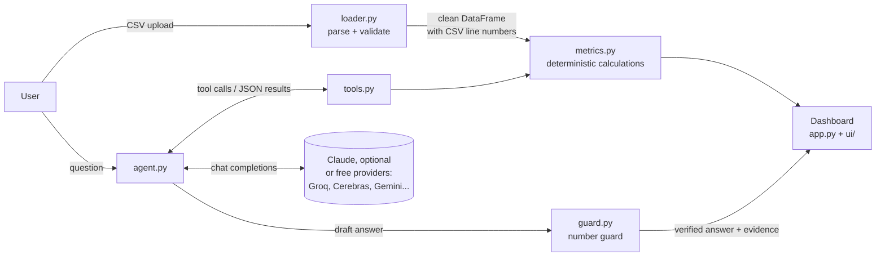

# Architecture

## Overview

Three layers, each testable on its own:

| Layer | Modules | Knows about the LLM? |
|---|---|---|
| Data | `loader.py` | No |
| Calculations | `metrics.py`, `evidence.py` | No |
| AI | `tools.py`, `llm.py`, `claude_provider.py`, `agent.py`, `guard.py` | Yes |
| UI | `app.py`, `ui/` | Only through `agent.answer_question` |

The dashboard uses the same `metrics` functions as the AI, so a figure in an answer and the same
figure on the dashboard always come from the same code.

## Request flow for a question

1. **Input checks.** Question trimmed, control characters removed, max 500 characters, max 30 per session.
2. **Prompt.** System prompt with the rules plus a dataset profile (months, category names; no money figures),
   up to 3 previous Q&A pairs with old citations removed, then the question.
3. **Tool loop** (max 6 LLM round trips, max 6 tool calls per round trip). The model may call 14 tools:
   - `get_period_summary`: totals, net revenue, margin
   - `get_monthly_trend`: per-month figures and MoM %
   - `explain_month_change`: a month vs the previous month, by category, with each category's share of the change
   - `get_top_categories`: largest categories with shares
   - `compare_periods`, `period_breakdown`: two periods side by side; quarters or years
   - `category_growth`, `category_trend`, `find_anomalies`, `expense_ratios`: growth, one category over time,
     unusual months, costs as a share of revenue
   - `what_if`, `project_trend`: scenarios and a labelled linear projection
   - `get_budget_status`, `get_cash_runway`: read what the user set on the Plan page

   Each call returns an `Evidence` record (result, formula, source CSV lines). The model receives only
   the JSON result plus an `evidence_id`. Invalid calls return an error message the model can act on
   (e.g. "'March' matches several months... ask the user which year").
4. **Number guard.** Every figure in the draft is extracted (handles ₹, Rs, commas, Indian grouping,
   k / lakh / crore / M / bn, %, "percent") and must be a correct rounding of a tool-result value.
5. **Correction or fallback.** If any figure is unsupported, the model gets one correction message
   naming those figures. If the rewrite still fails, the user sees the deterministic summaries of the
   evidence and an expander with the rejected draft.
6. **Display.** Status badge (verified / no figures / fallback / error), the answer, one expander per
   evidence item with formula, result table and source rows, plus provider, latency and token usage.

## Key design decisions

**Tool calling instead of putting the CSV in the prompt.** Pasting data into the prompt makes the model
do arithmetic, which LLMs get wrong, and doesn't scale past a few hundred rows. With tools, the model
only picks *which* calculation answers the question.

**Tool calling instead of LLM-generated pandas code.** Generated code would be flexible but would mean
executing untrusted code on the server and testing an unbounded space of programs. Fourteen fixed tools cover
the brief's scope and common analyst follow-ups (comparisons, growth, anomalies, ratios, what-ifs, projections), are fully unit-tested and cannot be abused. The cost is flexibility: questions that need
a calculation the tools don't provide are answered partially or fall back (see Limitations in the README).

**A guard after generation, not only instructions before it.** Prompt rules reduce hallucinated figures;
the guard makes sure none reach the user. It's precision-aware: "₹6.98 lakh" passes for 697,670.83,
"30%" fails for 28.76%. Percentages and money are matched separately.

**Precomputed explanations.** `explain_month_change` returns each category's change, % change, share of
the total change and transaction counts, so the model never needs to derive a figure to explain *why*.

**Evidence ids and CSV line numbers.** Every figure links to `[E1]`; every evidence item lists its source
rows with their line numbers in the uploaded file, so a reviewer can check them in Excel.

**Two providers, one client.** Groq and Gemini both expose OpenAI-compatible chat completions with
function calling. One small `requests`-based client handles both and falls back on 429/5xx/auth errors.

**Streamlit.** One Python codebase for UI and backend, free hosting with secrets management, and a
built-in test runner. The UI file contains no calculations.

## Validation rules (loader)

| Situation | Behaviour |
|---|---|
| Empty file, whitespace only, header only | Error |
| Binary / non-CSV content, wrong extension, > 5 MB, > 50,000 rows | Error |
| Missing required column | Error naming the missing column(s) and listing the columns found |
| Bad date, amount or type in a row | Row skipped and listed with its line number and reason |
| Row with the wrong number of fields | Row skipped and listed |
| More than 50% of rows invalid | Error: file is probably in the wrong format |
| Non-ISO dates | Parsed day-first, with a warning |
| Impossible ISO dates (2026-02-30, 2026-13-01) | Invalid, never reinterpreted |
| All expenses negative | Treated as a sign convention and flipped, with a warning |
| Some negative amounts | Kept as refunds/reversals, with a warning |
| Missing category column / blank category | "Uncategorized", with a warning |
| Category capitalisation differences | Merged, with a warning |
| Gaps between months, single month, duplicate rows | Warnings; MoM not computed across gaps |

## Failure modes

| Failure | What the user sees |
|---|---|
| No API key | Dashboard, Insights, Transactions and Plan work; Ask AI explains how to add a key |
| Provider rate-limited or down | That provider cools down for as long as it asked and the next configured one answers; if none can, one plain "busy, try again in a minute" message (details go to the server log); dashboard unaffected |
| Malformed tool call from the model (HTTP 400) | Retried once |
| Model calls an unknown tool or passes bad arguments | Error returned to the model, which can correct itself |
| Model states an unverified figure | One correction, then deterministic fallback with the rejected draft shown separately |
| Model loops on tool calls | Stopped after 6 round trips, deterministic fallback |
| Prompt injection in the CSV | Descriptions never sent; categories truncated and treated as data; any injected figure is blocked by the guard |

## Scaling notes (beyond the MVP)

- Calculations are vectorised pandas. Measured on a 50,000-row file: about 1.4 s to parse and validate (once per upload, then cached) and about 0.3 s for the four core calculations together.
- For multi-user production: move the calculation layer behind an API (FastAPI), add authentication,
  per-user rate limiting and a paid LLM tier with a data-processing agreement.
- More tools can be added in `metrics.py` + `tools.py` (the last eight were added this way);
  the guard needs no changes because it verifies against whatever the tools return.
- Free LLM tiers meter tokens per minute. Multi-tool questions can exceed that briefly; `llm.py` waits
  out short "try again in Ns" responses (up to `LLM_MAX_RATE_LIMIT_WAIT_S`) instead of failing.
